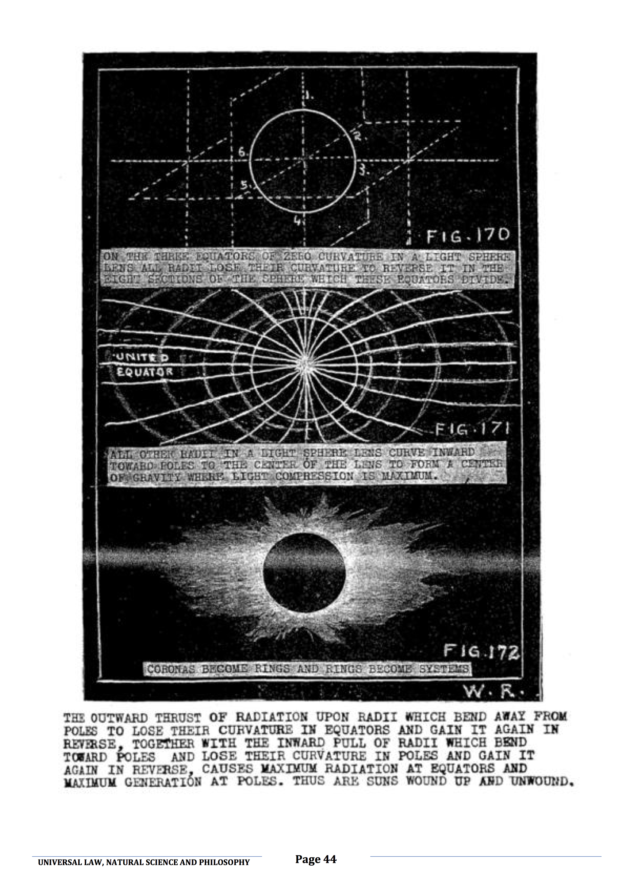

GEOMETOR • russell
==================

**Visit the Online Archive:** https://geometor.github.io/russell/

**Walter & Lao Russell • Home Study Course, Wave-Field Cosmogony • semantic digital archive**

Mission
-------

``geometor/russell`` is part of the interconnected `GEOMETOR <https://geometor.com>`_ semantic digital archive. Walter and Lao Russell's natural philosophy and universal cosmogony formulate rhythmic balanced interchange, the cube-sphere geometry of space, and the nine-octave periodic wave of matter. Within this archive, the complete 48 lessons of the Home Study Course and accompanying treatises are liberated from isolated print bounds into addressable semantic units, calibrated theme-adaptive vector diagrams, primary-source plate provenance, and exact symbolic formulations across the GEOMETOR corpus.

Books in This Archive
---------------------

- `The Wave-Field Cosmogony of Walter Russell <https://geometor.github.io/russell/cosmogony/>`_ — Synthesizing still magnetic light, the cube-sphere, opposing spiral cones, and the nine-octave periodic universe.
- `Home Study Course <https://geometor.github.io/russell/home_study_course/>`_ — Universal Law, Natural Science and Philosophy (1950–1952), presenting the complete 48 lessons across 12 units with parametric reconstructions of all 180 chalkboard figures.

Python Package & Modules
------------------------

The ``geometor-russell`` Python package (``import geometor.russell``) provides the executable symbolic geometry, construction, and compilation modules powering this archive:

- ``elements_data.py`` — Structured 9-Octave Periodic Element data for Walter Russell's Cosmogony.
- ``export.py`` — Exporters for GEOMETOR Russell 3D Cosmogony scenes (.obj, .json, .svg).
- ``models3d.py`` — Parametric 3D geometry generators for Walter Russell's Wave-Field Cosmogony.
- ``cli.py`` — CLI entry point for geometor.russell.

See the `API Reference <https://geometor.github.io/russell/modules/>`_ for full module documentation.

Repository Contents
-------------------

- ``docsrc/`` — Sphinx Book Codex source tracks, glossary, and apparatus compiled by `PHOTON publish <https://github.com/photon-platform/publish>`_.
- ``resources/`` — Curated lesson sources, plate scans, extracted docx media, and reference epubs/PDFs.
- ``src/geometor/russell/`` — Python package for text compilation, SVG diagram generation, and 3D cosmogony models.

Local Build & Verification
--------------------------

.. code-block:: bash

   publish build
   uv run --no-sync pytest

Part of the GEOMETOR Knowledge Archive
--------------------------------------

Explore all **74 Book Codices** and **11 Mathematical Catalogs** at https://geometor.com/books/.
