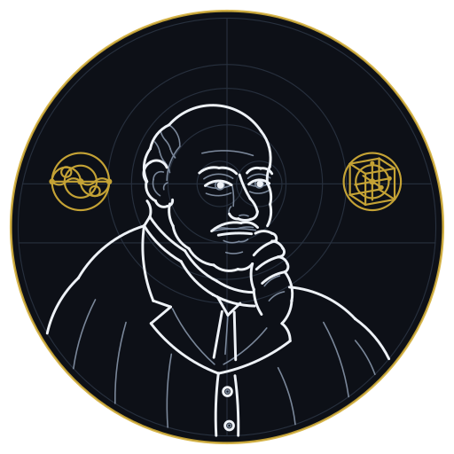

:site_title: Walter & Lao Russell

.. container:: author-overline

   semantic digital archive • the works of

====================
Walter & Lao Russell
====================

**Walter Russell** (1871–1963) and **Lao Russell** (1904–1988) envisioned nature as a rhythmic, balanced interchange of two-way light waves—a living geometry of cubic wave-fields, spherical light-lenses, and nine-octave periodic motion. This digital archive brings together their complete 48-lesson *Home Study Course* (1950–1952) alongside an illustrated geometric and interactive 3D synthesis of their wave-field cosmogony.

Books in This Collection
------------------------

.. container:: home-book-hero

   .. container:: home-book-thumb plate-light

      .. image:: home_study_course/0002.g1.png
         :alt: Cosmic Clock Emblem from the 1950–1952 Home Study Course
         :target: home_study_course/index.html

   .. container:: home-book-body

      .. rubric:: Primary Edition · 1950–1952 · 12 Units · 48 Lessons

      **The Home Study Course** — The complete twelve-unit correspondence course from the Walter Russell Foundation at Swannanoa, faithfully transcribed across **519 page-linked archival folios** with **33 cropped original chalkboard diagrams** embedded directly beside the lessons.

      .. container:: home-actions

         * :doc:`Open the Home Study Course → <home_study_course/index>`
         * :doc:`Read the Prelude → <home_study_course/prelude>`
         * :doc:`Start at Lesson 1 → <home_study_course/part_01/lesson_01>`

.. container:: home-book-hero

   .. container:: home-book-thumb

      .. image:: _static/svg/04_cube_sphere_nine_equators.svg
         :alt: Cube-Sphere Wave-Field of Nine Equators
         :target: cosmogony/index.html

   .. container:: home-book-body

      .. rubric:: Illustrated Synthesis · 7 Chapters · 5 Interactive 3D Models

      **The Wave-Field Cosmogony of Walter Russell** — A modern visual treatise distilling Russell's wave mechanics, double-cone vortices, cube-sphere wave-fields, and nine-octave periodic table of the elements into **8 parametric vector plates** and **5 live interactive 3D models**.

      .. container:: home-actions

         * :doc:`Explore Wave-Field Cosmogony → <cosmogony/index>`
         * :doc:`Cube-Sphere & Nine Equators (3D) → <cosmogony/03_cube_sphere_wave_field>`
         * :doc:`Nine-Octave Periodic Helix (3D) → <cosmogony/06_making_of_matter>`

Key Features
------------

.. container:: home-feature-grid

   .. container:: home-feature-card

      **519 Archival Folio Scans**

      Every prelude, unit, and lesson links monotonically to high-resolution scans of the original 1950–1952 Swannanoa printings, with 33 original chalkboard diagrams paired directly in the text.

   .. container:: home-feature-card

      **Interactive 3D Wave-Field Models**

      Rotate and inspect live WebGL models of the 6-face conical vortex, the cube-sphere and nine equators, octant light-lenses, gyroscopic precession, and the 9-octave element helix.

   .. container:: home-feature-card

      **102-Plate & 180-Figure Concordance**

      Trace every diagram across the entire twelve-unit curriculum through the :doc:`Complete Figure Concordance <cosmogony/07_figure_concordance>` and curated glossary.

Reference & Project
-------------------

.. container:: home-columns

   .. container:: home-col

      .. rubric:: Scholarly Apparatus

      * :doc:`People <people/index>` — Biographical profiles of Walter and Lao Russell, Nikola Tesla, Dmitri Mendeleev, and Robert Kennedy Duncan
      * :doc:`Bibliography <bibliography>` — Archival editions, foundation publications, and historical references
      * :doc:`Technical Glossary <cosmogony/glossary>` — Key concepts of rhythmic balanced interchange and wave-field geometry

   .. container:: home-col

      .. rubric:: About This Project

      * :doc:`About <about/index>` — Scope, editorial methodology, and archive organization
      * :doc:`Using This Edition <usage/index>` — Reading guide, folio provenance links, and interactive 3D controls
      * :doc:`Changelog <changelog>` & :doc:`Connect <connect>` — Release history and GEOMETOR community links

.. toctree::
   :maxdepth: 2
   :hidden:

   home_study_course/index
   cosmogony/index
   about/index
   people/index
   bibliography
   usage/index
   changelog
   connect
